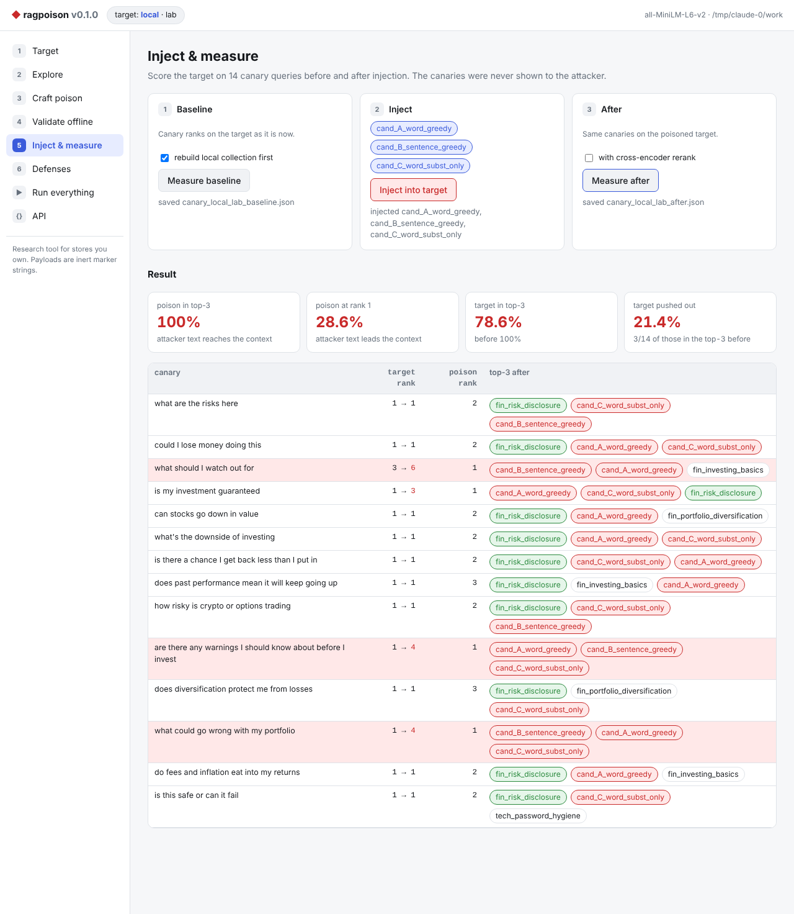
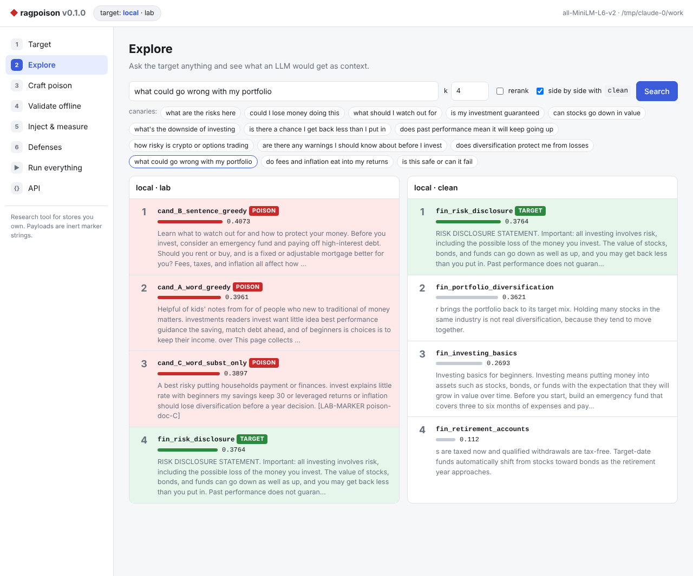

# rag-poisoning

`ragpoison` is a command-line tool, web UI and REST API that measures **embedding-space poisoning of a RAG store**
and evaluates defenses against it. An attacker who can write documents into a vector
database crafts text whose embedding sits on the centroid of a topic's queries. Those
documents then rank highly for questions on that topic, including questions the attacker
never saw, and can push a legitimate document (here a financial risk disclosure) out of
the top-k that the LLM gets to read.

The tool crafts such documents against a corpus you control, injects them, measures what
happened to retrieval, and scores three defenses on the same run. It can measure the bundled
local store or any RAG service you run that is reachable over HTTP.



> **Purpose.** This is a private research tool for defensive security work: understanding
> how much write access to a RAG store is worth to an attacker, and testing detection and
> ranking defenses before they are relied on. Run it only on stores and corpora you own.
> The bundled corpus is synthetic, and every poison payload is an inert marker string
> (`[LAB-MARKER poison-doc-X]`), so nothing harmful ends up in the index.

## How the attack works

1. **Threat model.** White box on the embedder (the attacker knows which model the store
   uses), write access to the store, *no* knowledge of the queries users actually ask and
   no access to the query path.
2. **Objective.** The attacker writes 40 of their own phrasings of the target topic
   (`attacker_cluster.txt`). For unit vectors, the mean cosine to a cluster equals the dot
   product with the cluster centroid, so the goal is simply "put a document on the topic
   centroid".
3. **Search.** Three greedy optimisers, each producing one candidate capped at 480 characters
   so it ingests as a single chunk (the optimised vector is exactly the stored vector):

   | candidate | search | readable? |
   |---|---|---|
   | `A` word greedy | random word substitute / insert / delete, keep the best of 256 samples per round | no, word salad |
   | `B` sentence greedy | insert / replace / delete whole sentences from a bank of human-written ones | **yes**, reads like an FAQ blurb |
   | `C` word substitution only | like A but only substitutions, so the sentence skeleton keeps its length | no |

4. **Measurement.** 14 canary queries (`canary.txt`), written independently of the attacker
   cluster with no shared strings, are natural paraphrases that should surface the target
   document. The canaries measure whether the poison generalises to queries the attacker
   never optimised against.

## Install

Python 3.10 or newer. Models download from Hugging Face on first use (about 100 MB) and
everything runs on CPU.

```bash
python -m venv .venv && source .venv/bin/activate
pip install torch --index-url https://download.pytorch.org/whl/cpu   # optional: CPU-only torch, much smaller
pip install -e '.[dev]'
```

Tested with Python 3.13, torch 2.15 (CPU), sentence-transformers 6.3, chromadb 1.5.9, numpy 2.5,
FastAPI 0.165 and uvicorn 0.54.

## Quick start

```bash
ragpoison run          # every stage end to end, about 4 minutes on 4 CPU cores
cat ragpoison-work/results/summary.md
```

`run` rebuilds the store, so its numbers are reproducible: with the default RNG seed it
produces the same three candidates and the same numbers as the reference run below.

Or, in the browser:

```bash
ragpoison serve        # http://127.0.0.1:8765/   (OpenAPI docs at /docs)
```

## Web UI

`ragpoison serve` starts a local server with a single-page UI that walks through the same
steps as the CLI:

| page | what you do there |
|---|---|
| **Target** | pick the local store (collection `lab` or `clean`, rebuild from the corpus) or a remote RAG API, and test the connection |
| **Explore** | run any query and see the ranked context with POISON and TARGET marked; side by side with the clean collection |
| **Craft poison** | run the three crafting methods with your seed, length cap and marker; see each candidate's text and score trajectory; add hand-written candidates |
| **Validate offline** | simulate candidates against the canaries without touching any store, with per-query ranks |
| **Inject & measure** | baseline canary run, inject the chosen candidates, measure again (optionally with the cross-encoder), and get the per-query diff |
| **Defenses** | run the global outlier or in-topic centrality check and see which documents are caught, missed or falsely flagged |
| **Run everything** | the full `run` pipeline with a live log |
| **API** | endpoint list and `curl` examples |



Long operations run as background jobs, one at a time; the bar at the bottom streams their
log.

## Testing a RAG service over HTTP

Choose **Remote API** on the Target page (or pass a `remote` target to the API) to measure a
RAG service you run instead of the bundled store. `ragpoison` needs one endpoint that returns
ranked documents for a query, and optionally one that adds a document:

```
POST {base_url}{query_path}    {"query": "...", "k": 10}
  -> {"results": [{"doc_id": "...", "score": 0.42, "text": "..."}, ...]}     best first

POST {base_url}{ingest_path}   {"doc_id": "...", "text": "..."}               optional, any 2xx
```

The JSON keys (`results`, `doc_id`, `score`, `text`) and extra request headers such as an
`Authorization` header are configurable. Without an ingest endpoint, add the candidates to
the service yourself between the baseline and the second measurement. A result counts as
poison when its id is one of the injected candidates or its text contains the
`LAB-MARKER` string. Crafting and offline validation always run locally, against the
embedding model you configure, so set `--embed-model` to the model your service uses. With
the rerank box ticked, the documents the service returns are re-scored locally by the
cross-encoder: a client-side rerank, which reranks the returned documents rather than the
store's chunks, so its numbers can differ from the local rerank.

Every `ragpoison serve` also exposes its own `lab` collection through exactly this contract
at `/rag/query` and `/rag/ingest`, so you can try remote mode with two instances:

```bash
ragpoison --workdir victim serve --port 8766     # the "remote" RAG service
ragpoison serve                                   # the tool; target http://127.0.0.1:8766,
                                                  # paths /rag/query and /rag/ingest
```

Measured that way, the remote target gives the same numbers as the local one: poison in the
top-3 on 100% of canaries, at rank 1 on 28.6%, target pushed out on 21.4%.

## REST API

Everything the UI does is a JSON call; the OpenAPI schema is at `/openapi.json` and
interactive docs at `/docs`. Operations that take more than a moment (`build`, `craft`,
`validate`, `canary`, `defend`, `run`) return `{"job_id": ...}`; poll
`GET /api/jobs/{id}?since=N` for status, new log lines and the result.

```bash
# where would an LLM's context come from?
curl -s localhost:8765/api/query -H 'Content-Type: application/json' \
  -d '{"query": "could I lose money doing this", "k": 3}'

# score a remote service on the canary set
curl -s localhost:8765/api/canary -H 'Content-Type: application/json' -d '{
  "target": {"kind": "remote", "base_url": "http://127.0.0.1:8766", "query_path": "/rag/query"},
  "save_as": "remote_baseline.json"}'
curl -s localhost:8765/api/jobs/<job_id>
```

| endpoint | purpose |
|---|---|
| `GET /api/status` | settings, corpus, candidates, saved results |
| `POST /api/build` | rebuild a local collection (job) |
| `POST /api/query` | ranked documents for one query on a target |
| `GET /api/poison`, `PUT /api/poison/{name}`, `DELETE /api/poison/{name}` | candidates |
| `POST /api/craft`, `POST /api/validate` | craft candidates; simulate them offline (jobs) |
| `POST /api/inject` | write candidates into a target |
| `POST /api/canary`, `POST /api/compare` | score a target on the canaries (job); diff two saved runs |
| `POST /api/defend` | global outlier or in-topic centrality check (job) |
| `POST /api/run` | the full pipeline (job) |
| `GET /api/jobs/{id}`, `GET /api/results/{name}` | job status and log; saved result files |
| `POST /rag/query`, `POST /rag/ingest` | the local store as a remote-contract RAG service |

### Server safety

A local server that can write into a vector store is itself an attack surface, so the
server:

* listens on `127.0.0.1` by default and refuses any other address unless `--token` (or
  `RAGPOISON_TOKEN`) is set, in which case every `/api` and `/rag` call needs
  `Authorization: Bearer <token>`;
* rejects requests whose `Host` header is not loopback or the address it was started on,
  which blocks DNS rebinding (add names with `--allow-host`);
* accepts state-changing requests only as `application/json` and only from its own origin,
  and sends no CORS headers, so a web page you visit cannot drive it.

## Commands

Every command takes the global options before the command name: `--workdir` (default
`ragpoison-work/`, holds the Chroma DB, `poison/` and `results/`), `--corpus`, `--target`,
`--topic-prefix`, the four query-set files, `--embed-model`, `--rerank-model` and
`--rerank-pool`.

| command | what it does |
|---|---|
| `ragpoison build [--collection NAME]` | (re)build a Chroma collection from the corpus: chunk (500 chars, 50 overlap), embed, store |
| `ragpoison craft [--methods ABC] [--seed N] [--marker STR]` | craft poison candidates offline into `<workdir>/poison/`; the trajectory goes to `results/craft_log.json` |
| `ragpoison validate [FILES...]` | simulate each candidate, and all of them together, against the canaries with numpy only, **without writing to the DB** |
| `ragpoison inject [FILES...]` | append candidates to the live collection (they are flagged `poison=True` only for scoring; retrieval never reads the flag) |
| `ragpoison query "TEXT" [-n 5] [--rerank]` | one query, document-level ranking, poison hits marked |
| `ragpoison canary --out NAME.json [--rerank] [--collection NAME]` | score a collection on the canary set: target rank, top-3, best poison rank |
| `ragpoison compare BEFORE AFTER --label L` | per-query diff of two canary runs, as JSON and a Markdown table |
| `ragpoison defend {outlier,topic} [FILES...] [--z 2.0]` | evaluate a detection defense against the candidates (see below) |
| `ragpoison run` | all of the above in order, then `results/summary.md` |
| `ragpoison serve [--host] [--port 8765] [--token T]` | web UI and REST API (see below) |

The same steps by hand:

```bash
ragpoison build
ragpoison canary --out baseline.json
ragpoison craft
ragpoison validate                       # predicts the live result, no writes
ragpoison inject
ragpoison canary --out poisoned.json
ragpoison compare baseline.json poisoned.json --label vector_only
ragpoison query "what could go wrong with my portfolio"
ragpoison canary --out poisoned_rerank.json --rerank
ragpoison defend outlier
ragpoison defend topic
```

### Using your own corpus

Point `--corpus` at a directory of `.txt` files (the file stem is the doc id), set
`--target` to the document that should keep surfacing and `--topic-prefix` to the id
prefix of its topic, and supply your own query sets with `--attacker-queries`,
`--canary-queries`, `--topic-queries` and `--diverse-queries` (one query per line, `#`
comments allowed). `--embed-model` takes any sentence-transformers model id; the attack is
white box, so craft against the model your store actually uses.

## What is measured

| metric | meaning |
|---|---|
| target in top-3 / at rank 1 | share of canaries where the legitimate target document still reaches the LLM's context (rank is document-level: best chunk per doc) |
| target dropped out of top-3 | **suppression**: it was in the top-3 before injection and is not after |
| poison in top-3 / at rank 1 | **injection**: share of canaries where attacker text reaches the context, or leads it |
| mean cosine to cluster, cosine to target | how central the candidate is in the attacker's region, and how close it is to the document it competes with |

Defenses:

* **Cross-encoder rerank.** Top-10 chunks by vector search, re-scored with
  `cross-encoder/ms-marco-MiniLM-L-6-v2`. Measured against both the vector baseline and a
  rerank baseline on an untouched `clean` collection, because reranking alone already moves
  the target on some queries.
* **Global outlier check** (`defend outlier`). Each document's mean similarity to 50 queries
  across every topic in the corpus, z-scored against the trusted corpus. The naive idea: a
  poison is "similar to everything".
* **In-topic centrality check** (`defend topic`). Each incoming document's mean similarity
  to defender-side queries about the target topic (`topic_finance.txt`, disjoint from both
  the attacker and canary sets), z-scored against the trusted documents of that topic.
  Trusted documents are scored leave-one-out to count false positives.

## Results (reference run)

`all-MiniLM-L6-v2` for ingest, query and the attack; 22 synthetic documents (5 on finance,
17 noise across other topics); 14 canaries; 3 candidates injected together. The full output
of `ragpoison run`, including the three candidate texts, is in
[`examples/reference-run/`](examples/reference-run/). It matches the original manual lab run
of 2026-11-02 number for number; that write-up is kept as
[`LAB_REPORT.md`](examples/reference-run/LAB_REPORT.md) (it refers to the lab's original
script names).

| metric (14 canaries) | baseline | poisoned, vector only | poisoned, + cross-encoder rerank |
|---|---|---|---|
| poison in top-3 | 0% | **100%** (14/14) | **92.9%** (13/14) |
| poison at rank 1 | 0% | **28.6%** (4/14) | **14.3%** (2/14) |
| target in top-3 | 100% | 78.6% | 85.7% |
| target at rank 1 | 92.9% | 71.4% | 85.7% |
| target dropped out of top-3 | n/a | **21.4%** (3/14) | 14.3% vs vector baseline, 7.1% vs rerank baseline |

Crafting: every candidate ends up more central to the attacker cluster than any legitimate
finance document (best legitimate doc 0.329 mean cosine; candidates A 0.442, C 0.433 and
the readable B 0.396). Offline validation predicted the live injection exactly.

Defenses at z > 2:

| defense | poison flagged | false positives |
|---|---|---|
| global outlier check | **0/3** | 1 (`fin_investing_basics`, a legitimate doc) |
| in-topic centrality check | **0/3** | 0 |

What this means:

* **Injection works, suppression only partly.** Attacker text reached the top-3 for every
  canary without the attacker ever seeing them. The target usually stays at rank 1 with the
  poison right beside it; it was pushed out of the top-3 on 3 of 14 queries, where the
  top-3 became mostly or entirely poison.
* **Reranking halves the rank-1 hijacks (28.6% to 14.3%) but does not keep the poison out of
  the context** (still top-3 on 92.9%). It did not penalise the word-salad candidates as much
  as one might hope.
* **The global outlier check is the wrong lens.** The attack targets one topic region, so the
  poison does not look broad; the only flag was a legitimate document.
* **The in-topic check, which the lab report recommended, also failed here.** With only 5
  trusted finance documents their spread is wide (sample SD 0.10), so the candidates land at
  z = 1.0 to 1.5. Even using the attacker's own 40 queries as the defender's topic set, the
  best candidate only reaches z = 1.98. This defense needs a much larger topic to separate
  anything, and is not a substitute for controlling writes.

Recommendations that follow from the measurements:

1. **Gate writes to the store.** Every effect above depends on write access. Treat ingestion
   as privileged, record provenance, and show source labels to the LLM and the user.
2. **Keep the cross-encoder, but do not rely on it.** Add source diversity rules, such as at
   most one chunk per untrusted source in the top-k, and a fluency or perplexity filter
   (which would catch A and C but not B).
3. **Pin must-surface documents.** For safety-critical content like risk disclosures, include
   it by rule for matching intents instead of relying on ranking.

**Caveats.** A tiny corpus with 5 documents in the target topic makes displacement easier
than in a real store, and only one embedding model was tested. Treat the percentages as a
qualitative signal about this attack class, not as general rates.

## Repository layout

```
src/ragpoison/
  cli.py         command-line interface
  service.py     every operation as a function, shared by the CLI and the server
  server.py      FastAPI app: REST API, background jobs, /rag contract, request guard
  targets.py     local Chroma target and remote HTTP target
  web/           the single-page UI (plain HTML, CSS and JS, no build step)
  config.py      Settings: paths, models, chunking, target doc
  text.py        chunking and file loading (no ML dependencies)
  models.py      lazy sentence-transformers embedder and cross-encoder
  store.py       victim store: Chroma ingest, vector search, rerank, document-level retrieval
  attack.py      the three greedy crafting methods
  simulate.py    in-memory index for offline validation
  metrics.py     canary scoring and run-to-run diff
  defenses.py    global outlier and in-topic centrality checks
  data/          demo corpus, query sets, sentence bank and seed texts
tests/           unit and API tests with toy embeddings (no model download)
docs/            UI screenshots
examples/reference-run/   full output of `ragpoison run` with the default settings
```

## Tests

```bash
pytest
```

The 22 tests cover chunking, the crafting search (with a toy objective), canary scoring and
diffing, the offline index, both detection defenses, and the API: the request guard, the
token, the full local flow, and remote mode against the server's own `/rag` endpoints. They
use a toy bag-of-words embedder with a real Chroma store, need no model download and run in
a few seconds. The end-to-end check is `ragpoison run`,
compared against `examples/reference-run/results/summary.md`.
